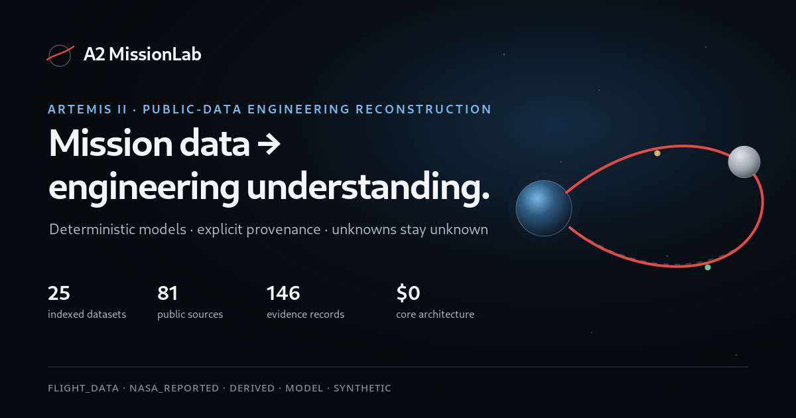
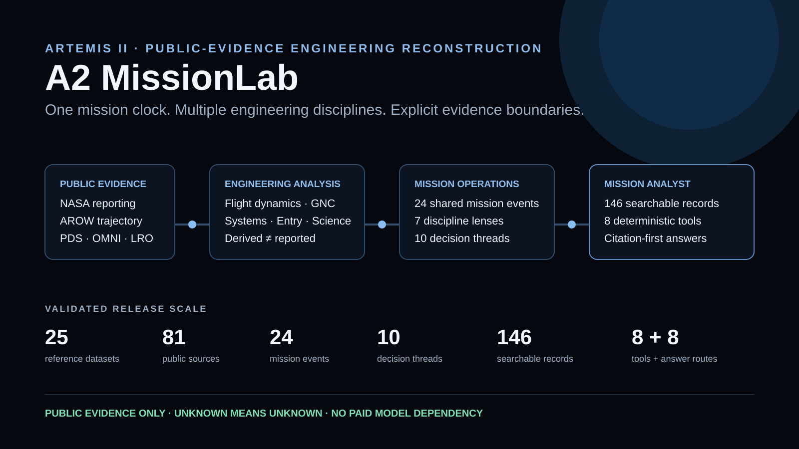

# A2 MissionLab

**Evidence-grounded Artemis II mission operations and engineering reconstruction built from public data.**

[Launch MissionLab](https://prakhar2828.github.io/a2-missionlab/) · [Technical Report](https://prakhar2828.github.io/a2-missionlab/technical-report.html) · [Methodology](docs/METHODOLOGY.md) · [Validation](docs/VALIDATION_REPORT.md)



A2 MissionLab is an independent open-source project for exploring Artemis II as an integrated engineering system rather than a collection of isolated facts. It combines public flight-derived products, planetary geometry, NASA reporting, mission imagery, environmental data, bounded engineering models, and deterministic analysis into one evidence-aware experience.

> A2 MissionLab is not an official NASA application, is not NASA-endorsed, and does not use non-public NASA data, internal procedures, internal screenshots, or unpublished telemetry.

## Why MissionLab exists

Human-spaceflight information is scattered across trajectory files, mission updates, science archives, imagery, technical references, environmental datasets, and postflight reporting. MissionLab asks a narrower engineering question: **how much mission understanding can be reconstructed from public evidence without pretending the public record is complete?**

That constraint drives the project: calculations are reproducible, evidence classes are explicit, model assumptions are visible, and unknown public facts remain unknown.

## Mission experiences

| Experience | What it demonstrates |
|---|---|
| [Mission Explorer](https://prakhar2828.github.io/a2-missionlab/mission.html) | Earth–Moon trajectory, correction-maneuver context, entry/recovery, and space-weather mission context |
| [Through Orion's Windows](https://prakhar2828.github.io/a2-missionlab/windows.html) | 25 evidence-labeled mission images with geometry, provenance, and source context |
| [Guidance, Navigation & Control](https://prakhar2828.github.io/a2-missionlab/gnc.html) | Simplified closed-loop proximity-operations teaching model with auto, manual, and disturbance modes |
| [Mission Control](https://prakhar2828.github.io/a2-missionlab/mission-control.html) | Discipline lenses, public mission scenarios, evidence boundaries, and decision-thread reasoning |
| [Plume-Surface Interaction](https://prakhar2828.github.io/a2-missionlab/psi.html) | Future-Artemis educational model connecting plume geometry, regolith response, ejecta, and hardware exposure |
| [Mission Library](https://prakhar2828.github.io/a2-missionlab/library.html) | Searchable engineering knowledge system linking questions to explanations, evidence, artifacts, and sources |
| [Technical Report](https://prakhar2828.github.io/a2-missionlab/technical-report.html) | Methods, equations, assumptions, limitations, selected results, provenance, and reproducibility record |

## Data and evidence

The validated evidence spine currently contains:

| Inventory | Count |
|---|---:|
| Indexed reference datasets | 25 |
| Normalized public sources | 81 |
| Shared mission events | 24 |
| Decision threads | 10 |
| Postflight engineering records | 6 |
| Unified searchable analyst records | 146 |
| Deterministic analyst tools | 8 |
| Deterministic answer routes | 8 |

Representative public inputs include NASA Artemis II AROW flight-derived ephemeris products, the Artemis II Planetary Data System archive, public lunar-science products, NASA mission reporting, NASA CCMC/NAIRAS references, NASA OMNIWeb, NOAA SWPC definitions, and public engineering references. The repository preserves source identity and provenance rather than flattening every input into a single confidence level.

MissionLab uses these evidence classes:

```text
FLIGHT_DATA
NASA_REPORTED
DERIVED
MODEL
SYNTHETIC
```

Critical boundaries are intentional:

```text
MISSIONLAB DERIVED != NASA REPORTED
PUBLIC EVENT SEQUENCE != COMPLETE PRIVATE FLIGHT LOOP
TEMPORAL SEQUENCE != CAUSATION
TROUBLESHOOTING ACTION != CONFIRMED ROOT CAUSE
DISCIPLINE RELEVANCE != DECISION AUTHORITY
UNKNOWN PUBLIC FACT != PERMISSION TO INVENT
```

See [Methodology](docs/METHODOLOGY.md) and [Provenance Standard](docs/PROVENANCE.md).

## Architecture

```text
public mission sources
        │
        ▼
ingestion + normalization
        │
        ├── trajectory / OEM parsing
        ├── mission clock + event alignment
        └── source/provenance catalog
        │
        ▼
deterministic analysis + bounded models
        │
        ├── SPICE lunar geometry
        ├── GNC / maneuver / communications analysis
        ├── entry / heating / recovery models
        ├── space-weather / radiation interfaces
        └── lunar-science + mission-control synthesis
        │
        ▼
validated reference products
        │
        ├── Mission Analyst index
        ├── Technical Report + Mission Library
        └── interactive static web experiences
        │
        ▼
GitHub Pages ($0 core hosting)
```

Major analysis code lives under `scripts/analysis/`, `scripts/processing/`, and `scripts/analyst/`. Independent validators live under `scripts/validation/`. Curated evidence products live primarily under `data/reference/`.

## Simulation methodology

MissionLab does **not** present public-data reconstructions as private Orion telemetry. Its interactive models are educational engineering tools with explicit boundaries:

- **Trajectory correction:** simplified local-frame propagation to teach why small early ΔV changes can create larger downstream displacement.
- **GNC:** deterministic teaching model for closed-loop state estimation, guidance, control, disturbance response, and manual-vs-auto behavior; it does not reconstruct unpublished controller gains or onboard navigation states.
- **Entry:** public event timing plus bounded atmospheric/kinematic modeling and Sutton–Graves-style convective-heating reconstruction; modeled heating is not TPS telemetry.
- **Space weather:** public environmental measurements and interfaces are kept separate from astronaut dose claims.
- **PSI:** future-Artemis educational geometry/hazard model; it is not a flight-qualified plume solver.

## Selected results

Examples of reproducible MissionLab outputs include:

- refined lunar pericynthion: **2026-04-06 23:00:46.177998 UTC**
- Moon-center distance at refined pericynthion: **8,281.938 km**
- mean-radius lunar altitude: **6,544.538 km**
- protected entry reconstruction peak external convective heat flux: **~109.64 W/cm²**
- Evidence-Grounded Mission Analyst: **8 deterministic tools / 8 answer routes**, no paid model or API key required

These are MissionLab engineering products derived from public inputs and stated models unless explicitly labeled NASA-reported.

## Validation

A feature is not considered complete because it renders once. The release stack combines:

- Python syntax and schema checks
- public-text and markup integrity validation
- evidence/provenance validation
- pure-model regressions for trajectory, PSI, space weather, and entry
- protected Mission Explorer, Windows, GNC, and Mission Control browser regressions
- Mission Library / Technical Report publication regression
- typography and visual-hierarchy regression
- accessibility and responsive browser matrix
- performance, loading, and intentional-failure browser regression
- Phase O metadata/social/README presentation validation

Phase N qualification passed its dedicated Chrome/Edge normal-assets and intentional-failure matrix **80/80**, while preserving the Phase M **192-case** responsive/accessibility matrix. Physical iPhone Safari, Android Chrome, tablet hardware, and desktop Safari remain manual release-candidate targets unless explicitly run and recorded.

See [Validation Report](docs/VALIDATION_REPORT.md) and the phase-specific QA records under `docs/`.

## Demo media



The release overview summarizes the evidence spine from public mission data through deterministic analysis, Mission Control perspectives, and the citation-first Mission Analyst. The live route links above are the primary interactive demos; the repo-owned social preview is intentionally static so link unfurls do not depend on a third-party image host.

## Run locally

Clone the repository, then serve the static application from the repository root:

```bash
python -m venv .venv
```

Windows PowerShell:

```powershell
.\.venv\Scripts\Activate.ps1
pip install -r requirements.txt
python -m http.server 8000
```

Open `http://localhost:8000/`.

Build the Mission Analyst index:

```powershell
.\.venv\Scripts\python.exe scripts\analyst\mission_analyst.py build-index
```

Build the citation-first interface:

```powershell
.\.venv\Scripts\python.exe scripts\analyst\answer_mission_question.py build-interface
```

Ask a mission question:

```powershell
.\.venv\Scripts\python.exe scripts\analyst\answer_mission_question.py ask "Did the return link loss cause RTC2?"
```

## Zero-cost architecture

The core project is designed to operate at **$0 ongoing cost**:

- static GitHub Pages hosting
- repository-tracked public evidence products
- local Python analysis and deterministic tooling
- no required paid model
- no required API key for the Mission Analyst core
- no custom domain requirement

See [Zero-Cost Architecture](docs/ZERO_COST_ARCHITECTURE.md).

## Technical challenges

The project intentionally tackles problems that are easy to hide in a polished demo:

- aligning heterogeneous public sources to one mission clock
- separating reported facts, derived quantities, models, inferences, and unknowns
- preserving the distinction between public ephemeris and private onboard navigation state
- correlating maneuver, communications, thermal, environmental, and recovery evidence without implying causation
- keeping multiple interactive engineering experiences deterministic and testable in a static site
- supporting desktop and mobile layouts without collapsing every route into one generic dashboard
- failing gracefully when optional imagery or data assets are unavailable

## Limitations

MissionLab is bounded by the public record. It does not reconstruct private flight-controller dialogue, unpublished flight rules, exact Orion onboard navigation states, undisclosed controller gains, private telemetry, or unknown root causes. Simplified teaching models trade fidelity for transparency and are labeled accordingly.

The current public site is static and client-side. GitHub Pages deployment is intentionally separate from local qualification, and no release phase automatically pushes, deploys, or rewrites `main`.

## Project status

**Phases 0 through 9 are complete** relative to defensible public evidence and the validated publication scope. The current quality-recovery branch has additionally completed protected experience recovery/polish through Phase N, with Phase O dedicated to README, GitHub presentation, social metadata, and demo media.

## Documentation

- [Technical methodology](docs/METHODOLOGY.md)
- [Validation report](docs/VALIDATION_REPORT.md)
- [Provenance standard](docs/PROVENANCE.md)
- [Mission Analyst guide](docs/ANALYST_GUIDE.md)
- [Publication summary](docs/PUBLICATION_SUMMARY.md)
- [Engineering log](docs/ENGINEERING_LOG.md)
- [Roadmap](docs/ROADMAP.md)
- [Disclaimer](DISCLAIMER.md)

## License

MIT. See [LICENSE](LICENSE).
